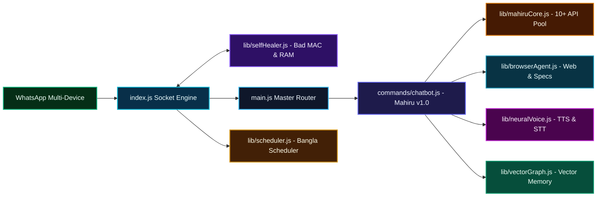

<div align="center">

<!-- ⚡ ANIMATED CYBERPUNK WAVE BANNER (HIGH-CONTRAST DARK GRADIENT) -->


<!-- ⌨️ LIVE ANIMATED TYPING TERMINAL -->
<a href="https://mahiru-shiina-ai.vercel.app">
  
</a>

<br/>

<!-- 🏷️ RAZOR-SHARP HIGH-CONTRAST STATUS BADGES -->
<p>
  
  
  
  
  
</p>

<!-- 🌐 CLICKABLE HIGH-CONTRAST PORTAL DOCK -->
<p>
  <a href="https://mahiru-shiina-ai.vercel.app">
    
  </a>
  <a href="https://mahiru-shiina-ai.vercel.app/root-check">
    
  </a>
  <a href="https://mahiru-shiina-ai.vercel.app/downloads">
    
  </a>
  <a href="https://mahiru-shiina-ai.vercel.app/hire-me">
    
  </a>
</p>

<!-- ✨ NEON GRADIENT DIVIDER -->


</div>

<br/>

> [!IMPORTANT]
> **⚡ MAHIRU SHIINA • Mahiru v1.0** হলো একটি প্রোডাকশন-রেডি, সেলফ-হিলিং হোয়াটসঅ্যাপ AI অপারেটিং সিস্টেম—যা মাত্র **400 MB RAM** কন্টেইনারে ২৪/৭ জিরো-ডাউনটাইমে চলার জন্য তৈরি। এতে রয়েছে ১০+ API রাউন্ড-রবিন লোড ব্যালেন্সিং, নিউরাল বাংলা ভয়েস স্টুডিও, অটো `Bad MAC` সেশন সার্জন, বাংলা/বাংলিশ স্মার্ট মিররিং, ন্যাচারাল টাইম শিডিউলার ও ইনস্ট্যান্ট ক্লায়েন্ট লিড এস্কেলেশন।

<br/>

<div align="center">
  <table>
    <tr>
      <td align="center" width="20%"><h3>⚡ 10+ APIs</h3><sub>Round-Robin Failover</sub></td>
      <td align="center" width="20%"><h3>🩺 100/100</h3><sub>SRE Auto-Healer</sub></td>
      <td align="center" width="20%"><h3>🎙️ 0ms</h3><sub>Opus Voice Cache</sub></td>
      <td align="center" width="20%"><h3>📱 30 Days</h3><sub>Phone Spec Cache</sub></td>
      <td align="center" width="20%"><h3>♻️ .fx</h3><sub>1-Click Recovery</sub></td>
    </tr>
  </table>
</div>

---

## 🌌 নিয়ন লাইভ সিস্টেম আর্কিটেকচার



---

## ⚡ প্রিমিয়াম ফিচার ম্যাট্রিক্স

<table>
  <tr>
    <td width="50%" valign="top">
      <h3>🧠 Mahiru v1.0 AI Core & Mirroring</h3>
      <ul>
        <li><b>Multi-API Failover:</b> <kbd>Gemini Flash</kbd> <kbd>Groq</kbd> <kbd>OpenRouter</kbd> <kbd>DeepSeek</kbd> <kbd>Cerebras</kbd> <kbd>Mistral</kbd> লাইভ অটো-ডিসকভারি।</li>
        <li><b>Bangla / Banglish Mirror:</b> যে শুধু বাংলায় লেখে তার সাথে ১০০% বাংলা, আর বাংলিশ ইউজারের সাথে ন্যাচারাল মিররিং।</li>
        <li><b>Adaptive Self-Learning:</b> মালিক ও ইউজারদের কথার ধরন, আগ্রহ ও ফ্যাক্টস স্বয়ংক্রিয়ভাবে শিখে রাখে।</li>
        <li><b>DIY Root Firewall & Lead Alert:</b> রুট স্টেপ লিক বন্ধ রাখে এবং আগ্রহী ক্লায়েন্টের নাম-নম্বর সরাসরি ওনার ইনবক্সে পাঠায়।</li>
      </ul>
    </td>
    <td width="50%" valign="top">
      <h3>🩺 SRE Self-Healer & Zero-Downtime</h3>
      <ul>
        <li><b>Bad MAC Surgeon:</b> লগআউট ছাড়াই নষ্ট সেশন ফাইল শনাক্ত করে অটো-রিসেট ও কনসোল স্প্যাম সাপ্রেশন।</li>
        <li><b>Dual Creds Vault:</b> <code>creds.json</code>-এর ২-স্তরের MD5 শ্যাডো ব্যাকআপ—করাপ্ট হলে অটো রোলব্যাক।</li>
        <li><b>400MB RAM Governor:</b> ৩-স্তরের মেমোরি ক্লিনার, ইভেন্ট-লুপ ল্যাগ মনিটর ও <code>428</code> আউটবক্স রিট্রাই কিউ।</li>
        <li><b>1-Click Recovery & Backup:</b> <kbd>.fx</kbd> দিয়ে ফুল রিকভারি এবং রাত ৩টায় অটো Gzip ব্যাকআপ (Local + WA + TG)।</li>
      </ul>
    </td>
  </tr>
  <tr>
    <td width="50%" valign="top">
      <h3>🎙️ Neural Voice Studio & Deep Media</h3>
      <ul>
        <li><b>Emotion-Aware TTS:</b> Cloned / Gemini Flash-TTS Round-Robin / ফ্রি বাংলা ফলব্যাক ও FFmpeg মাস্টারিং।</li>
        <li><b>0ms Instant Cache:</b> বারবার ব্যবহৃত ভয়েস লোকাল Opus ক্যাশ থেকে তাৎক্ষণিক ডেলিভারি।</li>
        <li><b>Multi-Key STT:</b> Groq Whisper Turbo + Gemini Audio ফলব্যাক ও বক্তার মুড ডিটেকশন।</li>
        <li><b>Deep Vision:</b> ছবি, 2x2 ভিডিও ফ্রেম + অডিও ও PDF/কোড ডকুমেন্ট অটো বিশ্লেষণ।</li>
      </ul>
    </td>
    <td width="50%" valign="top">
      <h3>🌐 Browser Agent & Smart Scheduler</h3>
      <ul>
        <li><b>4-Layer Web Search:</b> Tavily → Brave → DDG HTML → DDG Lite → Wiki (CAPTCHA/Cloudflare শিল্ডসহ)।</li>
        <li><b>Exact Phone-Spec Verifier:</b> 4G/5G মিসম্যাচ রোধ, জিরো-হ্যালুসিনেশন ও ৩০ দিনের ভেরিফায়েড স্পেক ক্যাশ।</li>
        <li><b>Natural Bangla Scheduler:</b> <code>আজ দুপুর ১২:৩০</code>, <code>রাত সাড়ে ৯টা</code>, <code>২০ মিনিট পর</code>—যেকোনো বাংলা সময় পার্সিং।</li>
        <li><b>24/7 Web Watchdog:</b> নির্দিষ্ট ওয়েবসাইটে আপডেট এলেই সরাসরি হোয়াটসঅ্যাপে অ্যালার্ট।</li>
      </ul>
    </td>
  </tr>
</table>

---

## 🗂️ প্রজেক্ট স্ট্রাকচার

```text
primemonir/wa-bot
├── 📂 assets/                # Brand banners, stickers & media assets
├── 📂 commands/              # Modular command handlers (chatbot, media, group, fun)
│   └── 📄 chatbot.js         # Mahiru v1.0 AI engine, Omni voice/text brain & media analyzer
├── 📂 data/                  # Persistent JSON DB, snapshots, Gzip backups & voice cache
├── 📂 lib/                   # Production core engines & zero-downtime modules
│   ├── 📄 mahiruCore.js        # Multi-API pool, Bangla/Banglish mirror & lead escalation
│   ├── 📄 selfHealer.js      # SRE watchdog, Bad MAC surgeon, RAM governor & outbox queue
│   ├── 📄 scheduler.js       # Natural Bangla/English Dhaka-timezone persistent scheduler
│   ├── 📄 browserAgent.js    # CAPTCHA-safe research, 30d phone-spec cache & OTG fetcher
│   ├── 📄 neuralVoice.js     # Studio-mastered Opus TTS, 0ms cache & Whisper/Gemini STT
│   ├── 📄 primeKnowledge.js  # MAHIRU SHIINA service desk, OTG guides & 9 portal routes
│   ├── 📄 vectorGraph.js     # Semantic long-term memory graph & entity recall
│   ├── 📄 callBlocker.js     # Automated call blocker with VIP whitelist & voice notice
│   └── 📄 systemControl.js   # Concurrency queue, anti-abuse guard & command lock
├── 📂 session/               # WhatsApp Multi-Device auth state (Keep Private!)
├── 📄 index.js               # Socket lifecycle, single-flight reconnect & pairing login
├── 📄 main.js                # Master router, .fx recovery, fuzzy suggest & visiting menus
├── 📄 settings.js            # Core bot metadata & owner configuration
├── 📄 config.js              # Runtime bridge configuration
└── 📄 package.json           # Dependencies & startup scripts
```

---

## 🎮 কমান্ড সেন্টার (সুপার শর্টকাট ও ট্যাপ-টু-ফিল)

<details open>
<summary><b>👑 ওনার কন্ট্রোল, SRE সেলফ-হিলার ও অটো-রিকভারি</b></summary>

<br/>

| শর্টকাট | মূল কমান্ড | কাজ ও বিবরণ |
| :---: | :---: | :--- |
| <kbd>.fx</kbd> | `.fix` / `.recover` | **১-ক্লিক ফুল রিকভারি** — JSON ভেরিফাই, API/ভয়েস রিসেট, RAM ক্লিন ও আউটবক্স ফ্লাশ |
| <kbd>.hl</kbd> | `.heal` / `.sre` | লাইভ SRE হেলথ স্কোর (`0–100`), RAM ট্রেন্ড, লুপ ল্যাগ ও প্রটেকশন স্কোরকার্ড |
| <kbd>.doc</kbd> | `.doctor` | ৭-পয়েন্ট ফুল সিস্টেম ডায়াগনস্টিক রিপোর্ট |
| <kbd>.bk</kbd> | `.backup` | তাৎক্ষণিক লেভেল-৯ Gzip ব্যাকআপ (Local + WhatsApp + Telegram/Cloud) |
| <kbd>.ram</kbd> | `.heal ram` | ডিপ RAM, টেম্প ফাইল ও ভয়েস ক্যাশ ক্লিন |
| <kbd>.rp</kbd> | `.report` | ২৪ ঘণ্টার এক্সিকিউটিভ ইনবক্স রিপোর্ট |
| <kbd>.ld</kbd> | `.leads` | আগ্রহী ক্লায়েন্ট লিডস তালিকা (`.ld clear` দিয়ে মুছা) |
| <kbd>.sm</kbd> | `.summary` | সর্বশেষ অ্যাক্টিভিটি ও অ্যালার্ট সামারি |
| <kbd>.ol</kbd> | `.offlist` | চ্যাটবট বন্ধ থাকা ইনবক্সগুলোর নম্বর তালিকা |
| <kbd>.cb</kbd> | `.callblock` | স্মার্ট কল ব্লকার (`on`, `off`, VIP ম্যানেজমেন্ট) |
| <kbd>.sch</kbd> | `.schedule` | ন্যাচারাল বাংলায় মেসেজ, ভয়েস বা কল রিমাইন্ডার শিডিউল |

</details>

<details>
<summary><b>🧠 মাহিরু v1.0 AI, নিউরাল ভয়েস ও রিসার্চ</b></summary>

<br/>

| শর্টকাট | মূল কমান্ড | কাজ ও বিবরণ |
| :---: | :---: | :--- |
| <kbd>.st</kbd> | `.mahiru status` | ১০+ API পুল, রিসার্চ ক্যাশ ও ইঞ্জিন লাইভ স্ট্যাটাস |
| <kbd>.vc</kbd> | `.mahiru voice` | ভয়েস স্টুডিও সেটিংস, ক্যাশ ও `.vc test <কথা>` |
| <kbd>.rs</kbd> | `.mahiru research` | মাল্টি-সাইট ডিপ ওয়েব রিসার্চ ও ওয়েবসাইট লিংক পড়া |
| <kbd>.pr</kbd> | `.mahiru profile` | এই চ্যাটের শেখা প্রোফাইল, ভাষা ও আগ্রহের বিষয় দেখা |
| <kbd>.ln</kbd> | `.mahiru lang` | ভাষা লক করা (`bn` / `banglish` / `auto`) |
| <kbd>.gr</kbd> | `.mahiru graph` | ভেক্টর মেমোরি গ্রাফ স্ট্যাটস, সার্চ ও কম্প্রেস |
| <kbd>.ra</kbd> | `.mahiru resetapi` | সব LLM ও TTS API কুলডাউন রিসেট ও লাইভ মডেল রিফ্রেশ |

</details>

<details>
<summary><b>⚡ ভিজিটিং কার্ড, পোর্টাল, মিডিয়া ও গ্রুপ টুলস</b></summary>

<br/>

| শর্টকাট | মূল কমান্ড | কাজ ও বিবরণ |
| :---: | :---: | :--- |
| <kbd>.m</kbd> | `.menu` / `.help` | মোবাইল-ফিট ক্যাটাগরি মেনু (`.m ai`, `.m srv`, `.m dl`, `.m grp`, `.m fun`, `.m own`) |
| <kbd>.c</kbd> | `.card` / `.prime` | অফিশিয়াল **MAHIRU SHIINA Studio** ভিজিটিং কার্ড |
| <kbd>.links</kbd> | `.web` / `.site` | ওয়েবসাইটের সব ৯টি অফিশিয়াল পোর্টাল লিংক |
| <kbd>.play</kbd> | `.song` / `.video` | ইউটিউব অডিও ও ভিডিও ডাউনলোডার |
| <kbd>.tt</kbd> | `.fb` / `.ig` | টিকটক, ফেসবুক ও ইনস্টাগ্রাম ভিডিও ডাউনলোডার |
| <kbd>.s</kbd> | `.sticker` / `.crop` | ছবি/ভিডিও থেকে স্টিকার ও স্কয়ার ক্রপ স্টিকার |
| <kbd>.vv</kbd> | `.remini` / `.ss` | ViewOnce সেভার, HD ছবি এনহ্যান্সার ও ওয়েব স্ক্রিনশট |

</details>

---

## 🚀 দ্রুত সেটআপ ও ডিপ্লয়মেন্ট

### ১️⃣ ক্লোন ও প্যাকেজ ইনস্টল
```bash
git clone [https://github.com/primemonir/wa-bot.git](https://github.com/primemonir/wa-bot.git)
cd wa-bot
npm install --no-fund --no-audit
```

### ২️⃣ এনভায়রনমেন্ট ভ্যারিয়েবল (`.env`)
```env
# Multi-API AI Pool (_1 থেকে _15 পর্যন্ত আনলিমিটেড কী সাপোর্ট)
GEMINI_API_KEY=your_gemini_key_1
GEMINI_API_KEY_2=your_gemini_key_2
GROQ_API_KEY=your_groq_key_1
GROQ_API_KEY_2=your_groq_key_2
OPENROUTER_API_KEY=your_openrouter_key

# Optional Web Search Boosters
TAVILY_API_KEY=your_tavily_key
BRAVE_API_KEY=your_brave_key

# Optional Cloned Voice (ElevenLabs)
ELEVENLABS_API_KEY=your_elevenlabs_key
ELEVENLABS_VOICE_ID=your_voice_id

# Optional Nightly Telegram Gzip Backup
BACKUP_TG_BOT_TOKEN=your_telegram_bot_token
BACKUP_TG_CHAT_ID=your_telegram_chat_id
```

### ৩️⃣ প্রোডাকশন বট চালু করুন
```bash
node index.js
```

> [!CAUTION]
> **`session/`** ফোল্ডারে আপনার হোয়াটসঅ্যাপ লগইন ক্রেডেনশিয়াল (`creds.json`) থাকে। রিপোজিটরি কখনো পাবলিক করলে অবশ্যই `session/` ও `.env` ফাইল `.gitignore`-এ যুক্ত রাখুন।

---

## 🛠️ টেকনোলজি স্ট্যাক

<div align="center">
  
</div>

<br/>

<div align="center">
  
</div>

---

## ⚡ MAHIRU SHIINA • OFFICIAL TECH STUDIO

<div align="center">
  
</div>

<table>
  <tr>
    <td width="48%" valign="top">
      <div align="center">
        <h3>👑 MAHIRU SHIINA</h3>
        
        
      </div>
      <br/>
      <ul>
        <li><b>🏢 Studio:</b> MAHIRU SHIINA Official Tech Studio</li>
        <li><b>🤖 AI Engine:</b> Mahiru v1.0 (Autonomous Edition)</li>
        <li><b>📍 Location:</b> Dhaka, Bangladesh</li>
        <li><b>🌐 Website:</b> <a href="https://mahiru-shiina-ai.vercel.app">mahiru-shiina-ai.vercel.app</a></li>
        <li><b>💻 GitHub:</b> <a href="https://github.com/primemonir">@primemonir</a></li>
      </ul>
    </td>
    <td width="52%" valign="top">
      <h3>🔥 Studio Core Divisions</h3>
      <p>
        🔓 <b>Android Research Lab</b><br/>
        <sub>Safe Bootloader Unlock • KernelSU Next • Custom ROM & Unbrick</sub>
      </p>
      <p>
        🤖 <b>AI & Bot Automation</b><br/>
        <sub>Mahiru v1.0 • WhatsApp, Telegram & Zero-Downtime SRE Systems</sub>
      </p>
      <p>
        💻 <b>Full-Stack Web & App Dev</b><br/>
        <sub>React • Vite • Android Apps • Firebase & Supabase</sub>
      </p>
      <p>
        🔐 <b>VPN & Tunneling Suite</b><br/>
        <sub>Dark Tunnel • VLESS / Trojan High-Speed Bypass Configs</sub>
      </p>
    </td>
  </tr>
</table>

<div align="center">

<!-- ⚡ HIGH-CONTRAST STUDIO CONNECT DOCK -->
<p>
  <a href="https://mahiru-shiina-ai.vercel.app">
    
  </a>
  <a href="https://github.com/primemonir">
    
  </a>
  <a href="https://mahiru-shiina-ai.vercel.app/posts">
    
  </a>
  <a href="https://mahiru-shiina-ai.vercel.app/hire-me">
    
  </a>
</p>

<br/>

<!-- 🌊 HIGH-CONTRAST ANIMATED CYBERPUNK FOOTER -->


</div>

## 🔐 প্রয়োজনীয় Environment Variables

কিছু বাহ্যিক API-ভিত্তিক কমান্ডের জন্য Hosting Panel-এর Environment Variables-এ নিচের মানগুলো যোগ করতে হবে:

| Variable | কাজ |
|---|---|
| `TENOR_API_KEY` | Emoji Mix API |
| `TELEGRAM_BOT_TOKEN` | Telegram sticker pack downloader |

এই মানগুলো source code-এ রাখা হয় না। Telegram bot token আগে public repository-তে প্রকাশিত হয়ে থাকলে BotFather থেকে token revoke করে নতুন token ব্যবহার করুন।
